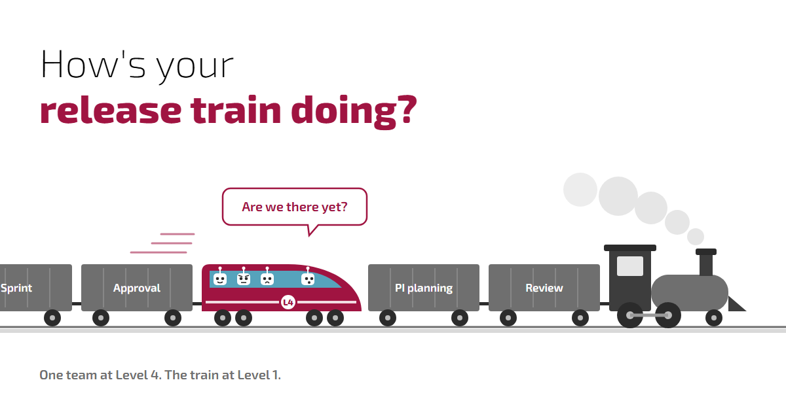
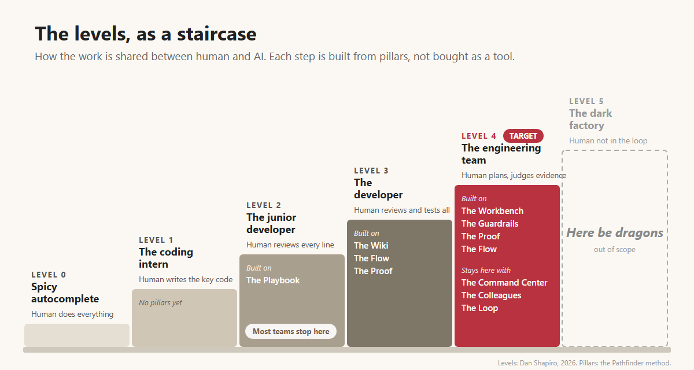

I haven't written a line of code in over a year.

I still ship software, more than before. Agents type it. My job is deciding what gets built,
setting up the environment the agents work in, and checking what comes back. Architect, owner,
manager. Not typist.

The setup, the guardrails and the habits are now reasonably well understood. This article is about
the part nobody has figured out yet: everything *around* that developer. The product, the other
teams, the planning, the release train, the budget. Because what I keep seeing is developers at
Level 4, working inside organizations still running at Level 1.

## First, a reminder: the five levels

In January 2026, Dan Shapiro described five levels of AI-assisted development, modelled on the
levels of self-driving cars. It's a useful map, so a quick tour:

- **Level 0, spicy autocomplete.** You write the code. The AI suggests the next line.
- **Level 1, the coding intern.** The AI writes boilerplate. You write what matters and review
  everything.
- **Level 2, the junior developer.** You and the AI pair. You still read every line.
- **Level 3, the developer.** The AI writes most of the code. You become a full-time reviewer.
- **Level 4, the engineering team.** Agents implement. You write specs and plans, and check the
  results. You are the manager.
- **Level 5, the dark factory.** Specs go in, software comes out. No human in the loop.

*Each step is built, not bought. The pillars come from the
[Pathfinder method](https://popescualextraian.github.io/pathfinder/method/).*

Shapiro makes a sharp point: most developers who call themselves AI-native stall at Level 2, and
every level feels like the finish line. It isn't.

Level 4 is realistic today. I work there. Level 5 is not, at least not for most of us. The few
teams that come close are tiny, have decades of experience in high-reliability systems, and spend
most of their agents' effort on testing and proving that the system works. Level 5 isn't a tool
you install. It's a test harness you earn.

So let's take Level 4 as the goal for a developer, and ask the next question.

## Let's imagine you're a 100% SAFe company

Picture twelve teams in two release trains. Every ten weeks, PI planning: two days, a big room,
a dependency board covered in red string. Story points measure velocity. It works, more or less.

Now one team gets to Level 4. Its throughput doesn't go up by 20%. It goes up several times. In
the first sprint, everyone is happy. In the second, the team runs out of refined stories. In the
third, it's blocked on another team's API, scheduled for the next PI. In the fourth, reviewers and
testers are drowning. By the end of the PI, the team's velocity chart looks great and the train
delivers exactly what it did before.

Nothing broke. The constraint just moved. When code gets several times cheaper, every step around
it becomes the bottleneck at once.

The numbers agree. In a McKinsey survey of about 300 companies, the typical gain from AI coding
tools was 5 to 15 percent. Top performers got five to six times faster time to market. The
difference wasn't the tool: they were seven times more likely to have changed their *workflows*
and six times more likely to have changed their *roles*. About 70 percent of companies hadn't
changed a single role.

So instead of "are your developers using AI?", ask four harder questions.

## Question 1: Are your *teams* at Level 4, and do they share anything?

In most organizations I see, Level 4 is an individual achievement: one person with a good setup
and their own tricks. When that person goes on holiday, the team drops back to Level 2. That's not
a team at Level 4. That's a hero.

Most teams aren't even there yet, because two hard decisions are still open. Should it be
*required*, when forcing it too early burns goodwill? Should it be *standardized*, when the tools
change every month? Both are fair questions. But while they stay open, everyone experiments alone
and nobody shares. Waiting for the dust to settle is a decision too, just one nobody chose on
purpose. Handing out licences doesn't settle it either: McKinsey described a rollout where usage
simply dropped, until training on real code, coaches for the first sprints and real measurement
turned it around. Scaling, they said, means getting twenty or thirty small things right at once.

A team at Level 4 has a shared setup: the same environment, rules and definition of "done", living
in the repository, not in someone's head. Across twelve teams, three things belong above the team:
**common guardrails** enforced as code, **contracts agents can read** (agents don't attend
meetings), and **a platform for agents**, one paved road instead of twelve setups.

**Ask yourself:** if your best agent user left tomorrow, would the team's way of working survive?
And would the team next door recognize it?

## Question 2: When building costs almost nothing, who says no?

A feature that used to take two sprints now takes two days. The catch: the backlog stops being a
queue and becomes a temptation. Every idea is "only a day". Six months later you have three times
the features, the same users, and a maintenance bill nobody planned for. Building got cheaper.
Owning didn't.

So the product role changes. **Discovery by prototype**: build all three designs, show them to
users, keep one. When a prototype takes an afternoon, a two-week sprint ending in a demo is mostly
waiting, so the best teams move to a continuous flow with the customer in the loop. **Saying no
becomes the main job**: the team will eat any amount of work. And **the spec becomes the main
artifact**: a vague story now produces vague software, very quickly.

**Ask yourself:** in the last quarter, how many features did you decide *not* to build?

## Question 3: How do you sell a month of work that now takes a week?

Much of our industry sells time: person-days, team capacity. At Level 4, that breaks. Paid by the
day, a supplier has an incentive to stay slow. On a fixed price built from old estimates, it keeps
the difference, until the customer asks why the price didn't drop. And customers already ask: "If
AI writes the code, why am I paying for the same team for the same time?"

The honest answer: they're not paying for typing any more. They're paying for decisions,
architecture, proof that it works, and someone who owns the result. That sells by outcome, not
headcount, and often with a smaller team: McKinsey tested pods of three to five product builders
directing agents, each delivering about what a full team did before. The calendar has to follow.
You can't show something new every few days and bill for a ten-week phase.

**Ask yourself:** if your teams were three times faster tomorrow, would your contracts reward
them, or punish them?

## Question 4: What do you measure now?

**Velocity** stops working. When agents do the effort, story points tell you nothing. Measure lead
time from idea to production, and whether the change moved anything for the user. Most companies
don't: in the McKinsey survey, only one in ten measured productivity at all.

**The individual** changes too. A Level 4 developer doesn't produce code. They produce decisions:
which approach, whether the spec is ready, whether the test proves anything, merge or throw away.
On a good day I make forty decisions, and most of them are right. **Decisions per day** describes
the work better than anything we track today. Use it as a lens, not a target, or people will make
small decisions quickly instead of big ones well.

Three more things need an owner. **Review** is the new bottleneck, so it moves up to specs, tests
and behavior. **Juniors** need a deliberate path, writing specs and owning small features, because
"they'll figure it out" is not a plan. And **tokens** are an operating cost, like cloud, that in
many companies nobody owns.

**Ask yourself:** does any metric on your dashboard still mean what it meant two years ago?

## What do the frameworks say?

To be fair, they're moving. In 2026, Scaled Agile released AI-Native SAFe, which treats agents
as teammates with defined responsibilities. TOGAF has no official answer yet, only useful
community work on AI governance.

My concern is the same for both: treating agents as *more capacity inside the same machine*. Same
trains, same planning, same ceremonies, now with AI. That's what our imaginary SAFe company did,
and it got the same delivery as before. The capacity wasn't the problem. The machine was.

I'm not saying throw out your framework. Look at every ceremony, handover and approval, and ask
whether it exists because humans were slow at writing code. If yes, it's a candidate for change.
And don't expect one answer for everything: modernizing a legacy system can run like what McKinsey
calls an "agent factory" (human writes the spec, agents build, human reviews), while a new feature
is a fast loop of options and choices. Same organization, two ways of working.

## What now?

When I stopped writing code, I didn't become less of an engineer. I moved up a level: from writing
code to owning the result. Organizations have to make the same move.

And one confession. Earlier I wrote: "I'm not saying throw out your framework." I was being polite.

Remember the move from waterfall to agile? Scrum, then SAFe, turned our industry upside down.
Companies spent billions on that transformation: coaches, certifications, reorganizations, whole
walls of sticky notes. And all of it was built to manage one scarce resource: developer hours.
Story points ration it. Sprints batch it. PI planning schedules it ten weeks ahead. That resource
isn't scarce any more. A process built around a constraint that no longer exists isn't a safety
net. It's a speed limit.

So don't add AI to your framework. The next transformation isn't "SAFe plus AI". Start from what
is scarce now: clear intent, good decisions, proof that it works, and someone who owns the result.
Keep only what serves those, even if that's none of it.

I haven't written a line of code in over a year, and nobody misses it. Pick one ceremony, stop it
next sprint, and see who misses that.

---

*Alex Popescu is a Lead IT Consultant, and hasn't written a line of code in over a year.*
