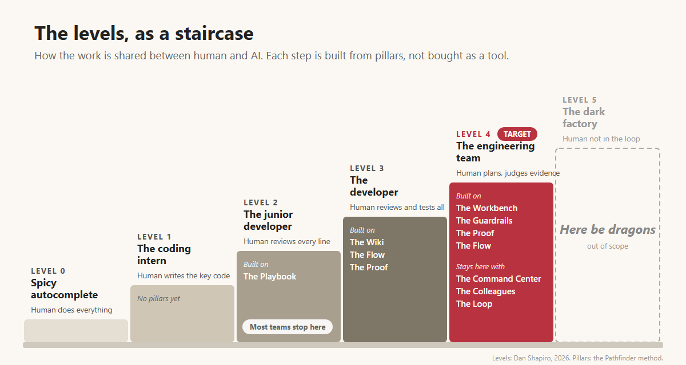

## Where the levels come from

The levels are Dan Shapiro's "The Five Levels: from Spicy Autocomplete to the Dark Factory"
(January 2026), modelled on the levels of driving automation. Like those, they start at 0, so
"five levels" means 0 to 5.

Shapiro's levels describe **how the work is shared between the human and the AI**. This method
keeps that meaning and adds, for each level, what you can observe, what typically holds a team
there, and which pillars it is built on. For Level 4, the target, it adds a definition in measurable
terms.

## The levels

| Level | Name | Who writes the code | What the human does |
|---|---|---|---|
| 0 | **Spicy autocomplete** | The human; the AI suggests the next line | Everything |
| 1 | **The coding intern** | The AI writes boilerplate and small snippets | Writes the important code, reviews all of the AI's |
| 2 | **The junior developer** | Human and AI together, as pair programmers | Reviews every line, as it is written |
| 3 | **The developer** | The AI writes most of the code | Reviews and tests everything, full time |
| 4 | **The engineering team** | Agents implement and test | Plans, answers questions, judges the evidence |
| 5 | **The dark factory** | A black box turns specs into software | Not in the loop |

Shapiro's sharpest observation: most developers who call themselves AI-native stay at Level 2,
because every level feels like the finish line.

## Reading the levels

- **A level describes a way of working, not a tool.** The same agent can be used at Level 1 or at
  Level 4. What differs is the setup and the habits around it.
- **Level by kind of task.** A team can work at Level 4 on routine features and at Level 2 on a
  difficult migration. Say which work you mean when you name a level.
- **The team's level, not the best individual's.** A setup that works only on one person's machine
  doesn't lift the team. When that person is away, the team drops back.
- **Higher is not always better.** For exploration, or for a change you don't yet understand
  yourself, Level 2 is the right level. Level 4 is for work you can describe well enough to
  delegate.

## Level by level

Each level is **built on** a set of pillars: the ones a team needs to stand there. To move up a
level, build what the next level stands on.

### Level 0 and 1: the AI as a typing aid

**You can see it when** the developer writes the code and accepts or rejects suggestions.
**What holds a team here:** habit, or rules that forbid more. **Built on:** no pillars yet.
Using a chat or agent for whole functions is the first step out.

### Level 2: pairing

**You can see it when** the developer and the agent work in one session, and the developer reads
every change as it happens. **What holds a team here:** the agent lacks tools, knowledge and a way
to check its work, so leaving it alone produces poor results. **Built on:** the first
instructions file (4 The Playbook).

### Level 3: the developer as reviewer and tester

**You can see it when** the agent produces whole changes, and the developer spends the day
reviewing them line by line and testing them by hand. Throughput rises, then stalls on the
human. **What holds a team here:** no proof the developer trusts, no sandbox, no plan detailed
enough to judge the result against. **Built on:** a written plan before implementing
(6 The Flow), the knowledge the code can't tell (3 The Wiki), and the agent running the tests
itself (8 The Proof).

### Level 4: the developer as manager

**You can see it when** the developer writes the plan with the agent, the agent implements and
tests without being watched, questions come back when the agent is stuck, and the developer
reviews a pull request with its evidence. Several tasks run at once. **Built on:** an isolated
environment per task (1 The Workbench), limits enforced in code (2 The Guardrails), evidence that
travels with the change (8 The Proof) and plans that state how the work will be proven
(6 The Flow). **What pulls a team back:** review that can't keep up, quality that erodes over
time, and a setup that grows until it is a burden. **What keeps it here:** a place to manage the
agents (7 The Command Center), agents that do recurring work (5 The Colleagues), and measuring
whether the setup works (9 The Loop).

### Level 5: the dark factory

Specs go in, software comes out, and no human reviews the code. The few teams that come close are
small, have long experience with high-reliability systems, and spend most of their agents' effort
on proving that the software works. The method does not cover Level 5: it is not realistic for
most teams yet, and the human stays accountable (principle 8). Level 5 isn't a tool you install;
it is a test harness you earn.

## Level 4 in measurable terms

"The human writes specs and manages agents" is a description of a role. To know whether a team
works at Level 4, look at what you can measure over a period of at least a month:

| Outcome | Level 4 when | Typical source |
|---|---|---|
| **Delegated work** | Most tasks are planned by a person and merged without a person editing the code | Pull request history |
| **Where human time goes** | Most human time per task is spent on planning and review, not on implementing or testing by hand | Time tracking or sampling |
| **Stability** | Change failure rate and escaped defects are no worse than the team's own baseline before agents | Incidents, defect tracker |
| **Code health** | Complexity, static-analysis warnings and duplication trend no worse than the baseline | Static analysis over time |
| **Cost** | Cost per merged task is known, and stable or falling | Agent and infrastructure bills |

"Most" and the period are placeholders until real teams give a basis to calibrate them. The
baseline is the team's own numbers from before it delegated; without one, record it now.

Speed alone is not an outcome here. Studies of AI adoption show speed gains that fade while code
quality drops: in one study of Cursor adoption, velocity gains faded after about two months while
static-analysis warnings and complexity stayed higher (https://arxiv.org/abs/2511.04427), and
DORA's 2024 report found stability falling as AI adoption rose. Stability and code health are what
guard against that.

## Sources

- Dan Shapiro, "The Five Levels: from Spicy Autocomplete to the Dark Factory", 23 Jan 2026,
  https://danshapiro.spicytakes.org/post/2026-01-23-the-five-levels-from-spicy-autocomplete-to-the-software-factory
- Simon Willison's summary, https://simonwillison.net/2026/Jan/28/the-five-levels/
