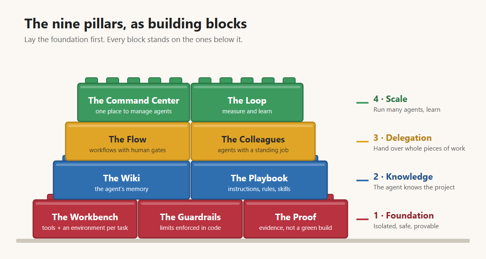

## The premise

Start from one assumption: coding agents are good enough to write decent code. Given a
well-described task, they read the code, change it, run the tests and open a pull request.

If that holds, the model is no longer what holds a team back. The setup around it is. An agent
without the project's tools guesses. An agent without guardrails has to be watched. An agent
without the knowledge the code can't tell reimplements what already exists. An agent without a
way to prove its work turns the developer into a full-time tester. A developer without a place to
follow several agents goes back to watching one terminal.

So the question this method answers is not "how do I prompt better", but: **what is the
architecture of a setup in which agents do the old jobs and the human leads?**

## The roles

| The human | The agent colleagues |
|---|---|
| Decides what to build and why | Implement |
| Designs: architecture, boundaries, the plan | Test |
| Approves at the gates that matter | Review each other's work |
| Manages: assigns work, follows several agents, steps in when one is stuck | Write and update the documentation |
| Stays accountable for what ships | Report what they did, with evidence |

The human becomes architect, approver and manager. Coding, testing, reviewing and documenting
move to agent colleagues. Teams that make this shift today usually do it alone, by trial and
error, and describe it in their own words. There is no shared vocabulary for what the setup must
provide.

## Building blocks

The method describes the setup as **building blocks**, like Lego: each pillar is a block with a
purpose of its own, and blocks stack. You lay the foundation first, and every block you add stands
on the ones below it. A team doesn't build everything at once; it builds the next block its
foundation can carry.

The foundation is what lets an agent work unattended at all: its own isolated environment with
every tool (the Workbench), limits enforced in code (the Guardrails) and tests that prove the work
(the Proof). Knowledge comes next, then the flows that hand over whole pieces of work, then the
tools to run many agents and learn from them. The order is a working hypothesis.

## What the method gives you

The method moves from theory to practice.

**The theory: what to build, and in what order.**

1. **Principles** (part 2, coming soon): the beliefs the rest follows from, and the
   decisions they imply.
2. **A way to see how far up you've built** (part 3, coming soon): where a team stands,
   in terms you can observe.
3. **Nine pillars** (part 4, coming soon): the building blocks, each with practices, common
   mistakes and a checklist.

**The practice: how to build it today.** *(coming next)*

4. **Each pillar, made concrete:** the possible technical implementations, from our own
   experience and from what today's tools can do. Tools change fast, so these are options, not
   requirements, and they will be updated as the tools move.
5. **A reference implementation** that shows the blocks fit together:
   - [Pathfinder Devbase](https://github.com/popescualextraian/pathfinder-dev-base): the
     foundation the agents work on (tools, an isolated environment per task, guardrails).
   - [Pathfinder UI](https://github.com/popescualextraian/pathfinder-dev-ui): the place where the
     human plans, approves and follows the agents.

   Others are possible; the method doesn't depend on either.

## What the method is not

- **Not tied to a tool.** The theory names properties a setup must have, not products. The
  practice part names tools as examples, and Pathfinder Devbase and Pathfinder UI are a reference
  implementation, not a requirement. Any setup that has the properties counts.
- **Not a replacement for your process.** It works inside Scrum, Kanban or anything else that
  plans work in reviewable pieces. It changes who does the implementing, not how a team decides
  what to build. Yet. Your sprint planning is safe, for now; the agents haven't asked for a seat at
  the retro.
- **Not about choosing a model or writing prompts.** The pillars apply to any capable coding agent.
- **Not proven at scale.** It comes from daily practice, is compared with current research and is
  used in real projects. What it doesn't have yet is validation across hundreds of teams, so its
  central claims are stated as hypotheses.

## Who it is for

Developers, tech leads and architects who already use a coding agent and want to move from pairing
with it to delegating to it; and the people who set up how a team works.
